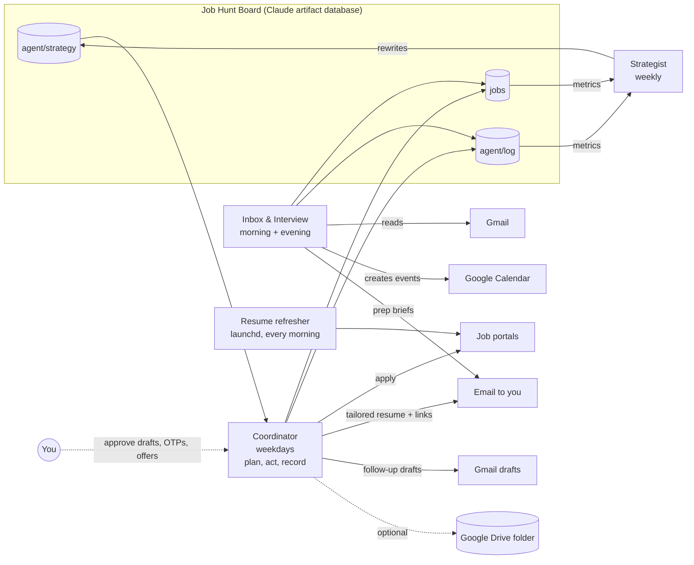

# Job Hunt Agent Kit

A small set of Claude agents and Mac scripts that run the boring parts of a job search for you:
they keep your resume fresh on job portals every morning, look for new matching jobs, apply where
you've allowed it, read your inbox for interview invites, put them on your calendar, write prep
notes the evening before, and once a week look at what's working and adjust the plan.

You fork it, fill in one settings file, run one setup script, and paste three prompts into Claude.
Anything risky (messages to recruiters, OTPs, offers) stays with you.

Created by Sashikanta Behera, who built and used the original version during his own job search.
Released under the MIT license.

## How it fits together



| Part | What it does | Runs where |
|---|---|---|
| Coordinator | Plans the day, applies (or only logs, in test mode), tailors resumes for career-site jobs, drafts follow-ups and referral notes | Claude scheduled task, uses your Mac's browser |
| Inbox & Interview | Sorts recruiter mail, adds interviews to your calendar, updates the board, sends prep briefs | Claude scheduled task (cloud) |
| Strategist | Measures response rates, rewrites the strategy, emails you a weekly report | Claude scheduled task (cloud) |
| Resume refresher | Re-uploads your resume on each portal once a day so your profile stays "recently updated" | macOS launchd + Playwright |
| Job Hunt Board | Kanban of every job, plus the agents' shared memory | Claude artifact with a database |

## Requirements

- A Mac (the refresh jobs use launchd) with Python 3.10+.
- A paid Claude plan with scheduled tasks, the Claude desktop app, and a browser Claude can drive
  (the built-in browser pane, or Claude in Chrome).
- Gmail and Google Calendar connected in Claude.
- Accounts on the portals you enable, and your resumes as .docx (or .pdf).

## Quick start in 6 steps

1. **Fork and clone** this repo into a folder you'll connect to the Claude desktop app, e.g. `~/JobHunt/job-hunt-agent-kit`.
2. **Run `./setup.sh`** once. It creates `config/settings.yaml` and stops.
3. **Fill in `config/settings.yaml`**: your facts, target roles, salary floor, portals, resume paths. Keep `test_mode: true` for now.
4. **Run `./setup.sh` again.** It validates your settings, installs Playwright, schedules the refresh jobs, and writes your agent prompts to `build/prompts/`. Then sign in once per portal: `./scripts/login.sh naukri` (and so on).
5. **Publish the board** (`board/index.html`) as a Claude artifact, paste its URL into `board_url`, run `./setup.sh` again. See [docs/BOARD.md](docs/BOARD.md).
6. **Create the three scheduled tasks** in Claude from `build/prompts/*.txt`. See [docs/AGENTS.md](docs/AGENTS.md).

After a week, look at what the coordinator logged. If it looks right, set `test_mode: false`, re-run
`./setup.sh`, and update the coordinator task's prompt with the new `build/prompts/coordinator.txt`.

**New here? Follow [docs/GETTING_STARTED.md](docs/GETTING_STARTED.md)** — a complete step-by-step guide from a fresh Mac to a running system (about 60–90 minutes). The condensed version is [docs/SETUP.md](docs/SETUP.md).

## Supported portals

| Portal | Daily resume refresh | Agent applies |
|---|---|---|
| Naukri | yes | direct "Apply" only |
| Hirist | yes | yes |
| Instahyre | yes | yes |
| Talent500 | yes (plus a session keep-alive) | yes |
| LinkedIn | no | Easy Apply only; referral notes are drafts for you |

Adding another one is mostly copying `refresh/portal_template.py`; see [CONTRIBUTING.md](CONTRIBUTING.md).

## Guardrails built into the prompts

- Never sends messages to recruiters or on LinkedIn. Follow-ups are Gmail drafts; referral notes are text for you to send.
- Never types passwords, OTPs or ID numbers. It stops and puts an "Action needed" card on the board.
- Only claims what is in your `facts`, and skips jobs that require anything in `never_claim`.
- Only emails you. Never accepts offers or negotiates.
- `test_mode: true` means it searches and logs, but never submits an application.

## Repo layout

```
config/       settings.example.yaml - the only file you edit
setup.sh      one-time (and re-runnable) setup
scripts/      login, pause, resume, uninstall, validate_config.py, render_prompts.py
refresh/      Playwright resume-refresh jobs + launchd templates
agents/       prompt templates for the three Claude agents
board/        the Job Hunt Board page and the starting strategy
tools/        tailor_resume.py - JD-specific resume copy (re-orders, never adds claims)
docs/         setup, agents, board, Google Drive, and a job-search playbook
```

## Privacy

Git-ignored, so they stay on your machine: `config/settings.yaml`, saved portal sessions
(`*_state.json`), logs, debug screenshots, `build/` (your rendered prompts contain your facts),
tailored resumes and any `.docx`/`.pdf`. Portal sessions live in `~/.job-hunt-kit/state` with
`600` permissions. The optional Naukri password is read from the macOS Keychain, never from a file.
Your board data lives in your private Claude artifact.

## Disclaimer

Automating actions on job sites may break their terms of service and could get an account limited.
You use this at your own risk. Keep the volume low (the defaults are a handful of applications a
day and one resume upload per portal), read what the agents log, and only enable what you're
comfortable with. Nothing here is affiliated with any job portal or with Anthropic.
